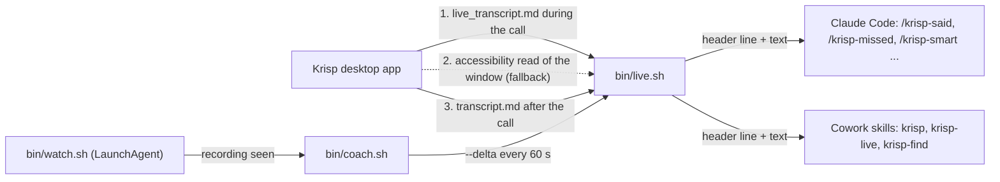

# krisp-live-copilot

A live meeting copilot for Claude Code and Claude Cowork that reads the Krisp desktop app's transcript while the call is still going.

> Unofficial. This project is not affiliated with, endorsed by or supported by Krisp. It reads files and screen text that the Krisp app already puts on your Mac, and it can break whenever Krisp changes how its app works.

## The problem

I am in a call and I want three things, fast: "what did they just ask me", "what did I miss while I was looking at the deck", and "one sharp point to make now". Krisp already transcribes the call, but getting that text into an assistant meant switching windows, copying the transcript and pasting it, mid-sentence. I built this so a single slash command gets the answer from the live transcript, with no copy and paste, in under 80 words I can read at a glance.

## How it works



`bin/live.sh` is the engine. Each command and skill asks it for the current transcript and gets back one header line (which transcript, why it was chosen, how old it is, which speaker is you) and then the text: the last N lines (`--tail N`) or only what was added since the last look (`--delta`).

It finds the call three ways, in order:
1. The live file. Krisp's Local Folder integration has a "live transcript" option that creates the meeting's .md when the call starts and grows it during the call. A Krisp file written in the last 150 seconds, or a `live_transcript.md` still open for this call, is the live call.
2. The accessibility read (macOS fallback). If the option is off, live.sh reads the caption text out of the Krisp window, drops the control labels, and grows a buffer with a wall-clock stamp per line.
3. The finished transcript. When the recording stops, Krisp writes `transcript.md` with speaker labels.

A transcript you pick with `/krisp-find` stays pinned until `/krisp-live` unpins it. The watcher notices a recording and starts a hands-free coach that writes at most three lines a minute to `notes/coach-<date>.md`. Details, including the selection table and the safety rules, are in [docs/architecture.md](docs/architecture.md).

| Ask | Command (Claude Code) | live.sh call |
|---|---|---|
| What did they just ask me | `/krisp-said` | `--tail 30` |
| What did I miss | `/krisp-missed` | `--delta`, `--tail 20` |
| One sharp point to make now | `/krisp-smart <topic>` | `--tail 60` |
| Questions to ask next | `/krisp-questions` | `--tail 80` |
| Five-line recap, or the long summary | `/krisp-recap`, `/krisp-summary` | `--tail 120`, all |
| Find and pin a past meeting | `/krisp-find 10/12`, `/krisp-use 1` | `--find`, `--use` |
| Follow the live call again | `/krisp-live` | `--live`, `--ax`, `--doctor` |
| File the asks as follow-ups | `/krisp-file` | all, then the adapter |
| After a mock interview: what was asked, how it landed, one rewrite | `/krisp-interview-review` | `--finished` (refuses a live call) |

The same modes exist as one Cowork skill (`skills/krisp`) plus two focused ones (`skills/krisp-live`, `skills/krisp-find`, which can fall back to a Krisp MCP connector when no Mac is linked).

## Quickstart

Run the tests and try the engine on the invented example meeting. This works on Linux or macOS, with no Krisp app:

```
git clone https://github.com/gkmr/krisp-live-copilot.git
cd krisp-live-copilot
chmod +x bin/*.sh
python3 tests/test_live.py

export KRISP_DIR=examples/krisp KRISP_STATE_DIR=$(mktemp -d) KRISP_FILE_ONLY=1
./bin/live.sh --find 10/12
./bin/live.sh --use 1
./bin/live.sh --tail 8
```

Use it in a real call (macOS, Krisp desktop app, Claude Code):

```
# once, in Krisp: Settings > Integrations > Local folder: pick a folder and turn on Live transcript
unset KRISP_STATE_DIR KRISP_FILE_ONLY        # if you ran the example above in this shell
export KRISP_DIR="$HOME/Meetings/Krisp"      # the folder you picked in Krisp
./bin/live.sh --doctor                       # is the live option ON, newest file, accessibility status
cp me.example.md me.md                       # optional: your name and the numbers you may cite
claude                                       # start it from this shell, then type /krisp-live, /krisp-said ...
```

Optional extras:
- Hands-free coach: `./bin/coach.sh` in a second terminal (needs the `claude` CLI). It sends new transcript lines to a model about every 60 seconds; read the next section first.
- Auto-start: fill in and load the LaunchAgent template, `launchd/com.example.krisp-watch.plist` (the commands are in the file).
- Cowork: zip each folder under `skills/` and upload it under Settings > Capabilities > Skills. The Cowork session must be linked to the Mac.

## Consent and recording law

- Tell everyone on the call that it is being recorded and transcribed, before you start.
- Follow the consent law where you and each participant are. Some places allow recording with one party's consent; others require every party to agree. When in doubt, ask everyone and record only with a clear yes. Check your employer's or client's policy too. This is not legal advice.
- The coach (`bin/coach.sh`, which the watcher starts on every recording) sends the new transcript lines to a model through the `claude` CLI about every 60 seconds. Turn it off for any call where that is not acceptable: set `KRISP_COACH=0` for the watcher, or `touch .state/coach-off` before the call (it also stops a running coach) and remove the file afterwards. The slash commands send transcript text only when you run one.
- Interview help is review-only. `/krisp-interview-review` works on the finished transcript of a mock or practice interview, after the call, and `live.sh --finished` refuses a transcript that is live or still being written. Nothing here drafts answers during a live interview.

## How it is verified

- `python3 tests/test_live.py`: 26 tests, Python standard library only, no network. They run live.sh in file mode (`KRISP_FILE_ONLY=1`) on a temporary copy of `examples/` and check:
  - `--tail 8` equals `examples/expected/tail-8.txt` and the file's last 8 lines;
  - `--delta` prints the whole file, then only the appended turns (`examples/expected/delta-after-append.txt`), then "nothing new"; it resets when the file shrinks; `KRISP_DELTA_NS` keeps separate offsets;
  - `--find` by date word (10/12, 10-12, Oct 12, october 12 all give `examples/expected/find-10-12.txt`), by a word said in the call, newest first, and no match;
  - a pin beats a newer live file until `--live`; file age picks LIVE FILE, "last 4 hours" or NOT live; an open `live_transcript.md` counts as live through a 10-minute silence; an empty folder says so;
  - safety: running every mode leaves the Krisp folder byte-for-byte and mtime unchanged, and a state folder inside it is refused (exit 2);
  - `--finished` refuses a transcript written in the last 150 seconds, an open `live_transcript.md` and a fresh pin, and prints a finished `transcript.md` whole; no command other than `/krisp-interview-review` mentions interviews;
  - `bash -n` on all three scripts, `watch.sh --once` starts nothing, and the "file it" adapter parses, skips done items and duplicates.
- Field checks on the author's Mac (manual, not automated): on Krisp 3.17.9, during a 23-minute in-person recording, words reached the accessibility buffer 2 to 3 seconds after they were spoken. The live file worked in 11 of 14 recordings, appeared 10 to 60 seconds after the call started and ran about 15 seconds behind at the end of a 34-minute call. The watcher started the coach on a new recording and the first coaching line was written 3 seconds after the recording was detected.

## Design decisions and tradeoffs

- One engine, many front ends. Every command and skill shells out to `live.sh`, so "which transcript is the call" lives in one tested place and the prompts stay short. The cost is a shell dependency on the Mac.
- The header line is a contract. Every print starts with the source, the reason and the age, and every prompt is told to read it first, so the model does not answer about an old file as if the call were live.
- File first, screen read second. The live file costs milliseconds and needs no permission. The accessibility read cost 3.5 seconds per dump and, after a Krisp redesign, 47 to 100 seconds, so it is gated (only when no file answers) and cached for 15 seconds.
- Byte offsets per transcript for "what did I miss". Cheap, shared across processes, and reset when Krisp rewrites the file. The tradeoff: by default the coach and `/krisp-missed` share one offset (see limitations).
- A pin beats the live call. Questions about last week's meeting should not switch sources when a new recording starts. The header always says "pinned" and `/krisp-live` unpins first.
- Read-only by default. "File it" is the one writing mode, and it goes through a small adapter: a local queue file unless you configure a task tool, which is read first and never deleted from.

## Limitations

- Live use needs macOS and the Krisp desktop app. The accessibility fallback depends on Krisp's window text and English control labels, which are not a public interface and can change with any update.
- Live lines carry no speaker labels (in the live file and the accessibility buffer), so "you" and "they" are inferred from the words. Labels arrive with `transcript.md` at stop.
- Without the live file, the Krisp caption panel is rolling: only lines on screen at or after the first read are captured. Run `/krisp-live` at the start of a call, or keep the watcher running.
- The meeting folder naming and transcript shape are taken from the author's Krisp install; `--find` date words assume US month/day and English month names.
- `--delta` offsets are shared by default, so with the coach running `/krisp-missed` only covers the time since the coach's last poll. Start the coach with `KRISP_DELTA_NS=coach` to separate them.
- The accessibility read, the watcher's live loop and the coach's model call are checked by hand on a Mac, not by the automated tests.
- The coach makes one short model call per minute while the transcript grows.

## Layout

```
krisp-live-copilot/
  bin/
    live.sh            the engine: finds the transcript, prints header + tail or delta
    watch.sh           LaunchAgent watcher: recording seen -> coach and optional hooks
    coach.sh           hands-free coach: claude -p on each delta, lines to notes/
  launchd/
    com.example.krisp-watch.plist   LaunchAgent template
  .claude/
    commands/          15 slash commands (/krisp-said, /krisp-missed, /krisp-smart ...)
    settings.json      allow live.sh, deny edits under ~/Meetings
  skills/
    krisp/             umbrella skill, all modes
    krisp-live/        follow the call in progress
    krisp-find/        find and pin a past meeting, Krisp MCP fallback
  adapters/file-it/    the optional "file it" adapter: README, config example, queue_to_tasks.py
  examples/            invented meetings in Krisp's local-folder shape, expected outputs
  tests/test_live.py   26 tests, stdlib only
  docs/architecture.md read paths, selection order, pin model, delta offsets, latency, safety
  CLAUDE.md            rules for the copilot in Claude Code
  me.example.md        optional profile: name, role, numbers you may cite
  CHANGELOG.md  LICENSE
```

MIT licensed. Copyright (c) 2026 Ganesh Kumar.
