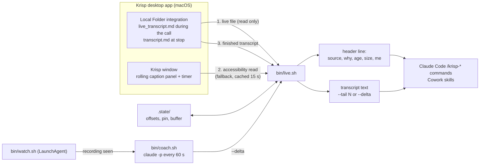
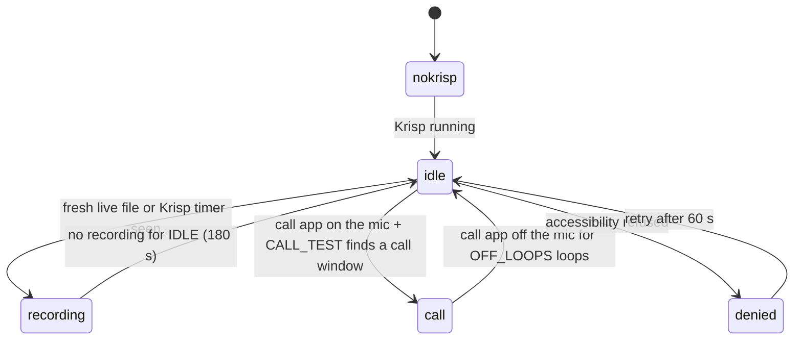

# Architecture

krisp-live-copilot is a thin layer over the Krisp desktop app. It does no transcription of its own. One shell script, `bin/live.sh`, answers a single question many times a minute: "what is the transcript of the call right now, and where did it come from?" Everything else (the Claude Code commands, the Cowork skills, the coach, the watcher) asks live.sh and then reasons over what it prints.

This project is unofficial and not affiliated with Krisp. It relies on how the Krisp app behaves on macOS, which Krisp can change at any time.

## The three read paths

### 1. The live file (preferred)

Krisp's Local Folder integration writes each meeting into a folder named `<app> meeting - <Month D, YYYY h-mm-ss PM>` under the folder the user picked (live.sh reads it from `KRISP_DIR`, default `~/Meetings/Krisp`). With the "live transcript" option on (Krisp Settings > Integrations > Local folder > Live transcript), the folder and a `live_transcript.md` appear when the call starts and grow during the call. When the recording stops Krisp writes `transcript.md`, which carries `**Speaker N | HH:MM:SS**` labels. The live file carries the time since the recording started but, in the Krisp builds this was built against, no speaker labels.

live.sh treats the newest Krisp `.md` as the live call when any of these hold:
- it was written in the last `LIVE_SECS` (150 s);
- it is a `live_transcript.md` with no `transcript.md` beside it (the call is still open, even through a long silence, up to 3 hours);
- it was born after the current recording began (when the accessibility path has seen Krisp's timer).

`live.sh --doctor` reads Krisp's own settings file, read only, and reports whether the live transcript option is ON or OFF.

### 2. The accessibility read (fallback, macOS only)

When the live file cannot answer (option off, or the file has not appeared yet), live.sh reads the call text out of the Krisp app with `osascript` and System Events: the static text of every Krisp window except the calendar notification. It then:
- Takes the widget window's clock-like value as the recording timer. Only `^[0-9]{1,2}:[0-9]{2}(:[0-9]{2})?$` counts; the widget's noise meter ("0%") once reset the buffer several times in one call before this check.
- Drops control labels (My accent, Others' accent, My noise, Other's noise, Take Notes, Transcript, Summary, Copy, Start or Stop recording, bare timers).
- Hashes each caption line (first 16 hex characters of SHA-1) into a seen list, so a line on screen across many reads is appended once.
- Replaces the last entry when the newest caption is the same sentence with more words, instead of appending it twice.
- Stamps each new line with the wall clock: `**Live | 21:04:51**`. The caption panel has no speaker labels, so neither does the buffer.
- Archives the buffer (`ax-<timestamp>.md`) and starts a new one when the timer goes backwards: a new recording.
- Trusts the last timer seen for 180 s, because a read can land between two redraws of the widget.
- Caches each dump for `AX_CACHE_SECS` (15 s), so chained calls (the watcher, the coach and a command) share one read.

The read is gated: it runs only when Krisp is running, the live file cannot answer, and either the live option is off or Krisp is on the microphone (an optional helper, `KRISP_MICUSERS`, lists the processes recording from the mic; without it the answer is "unknown" and the read runs).

### 3. The finished transcript

After the call, `transcript.md` is the source. A file written in the last 4 hours is reported as "newest file ... the call has ended"; anything older is reported as "newest on disk, NOT live", so the copilot never answers about an old meeting as if it were happening now. A clipboard path (`--clip`, after tapping Copy in Krisp) remains as a last resort.

### Selection order

| Rank | Source | Header says |
|---|---|---|
| 1 | a pinned transcript | `pinned (live.sh --live to unpin)` |
| 2 | Krisp .md written in the last 150 s | `LIVE FILE, Krisp is writing it during the call` |
| 3 | open live_transcript.md, no transcript.md yet | `LIVE FILE, still open for this call` |
| 4 | Krisp .md born after the current recording began | `LIVE FILE, created when this recording started` |
| 5 | accessibility buffer while Krisp's timer is visible | `LIVE, read from the Krisp app` |
| 6 | accessibility buffer under 3 hours old, newer than every file | `live buffer from the Krisp app` |
| 7 | clipboard copy under 3 hours old, newer than every file | `copied from the Krisp app` |
| 8 | newest .md written in the last 4 hours | `newest file, written in the last 4 hours` |
| 9 | newest .md on disk | `newest on disk, NOT live` |

Every print starts with one header line: `transcript: <meeting> | <why> | last write HH:MM:SS, <bytes> bytes | source: <live file, AX, AX cache or files> | krisp: <app status> | me: <Speaker N or unknown>`. The commands and skills are told to read it first and never call a file live when the header says otherwise.

## Pin and unpin

`--find <words>` lists up to 15 matches newest first and saves them to `.state/find.txt`. Date words are normalized (10/12, 10-12, Oct 12 and october 12 all become the folder's "October 12"); a word that is not in a folder name is searched inside the transcripts ("said in the call"). `--use <n>` writes that path to `.state/pinned.txt`, and from then on a pin beats every other source, including a live call that starts later. `--live` deletes the pin. `--which` shows the current choice and its path.

Why a pin beats a live call: when the user is asking several questions about last week's meeting, a new recording starting must not silently switch the source under them. The cost is the reverse risk (forgetting to unpin), which is why the header always says "pinned" and why `/krisp-live` unpins first.

## After-call review only: --finished

`--finished` prints the whole transcript only when it is finished: a `transcript.md` (not `live_transcript.md`, the accessibility buffer or a clipboard copy), whose source is not live, and that was not written in the last `LIVE_SECS` (150 s). Anything else gets one line, "not a finished transcript: ...", and no transcript text. `/krisp-interview-review` reads only this mode, so reviewing a mock or practice interview is possible after the call and drafting answers during a live one is not. The rule is enforced in the engine, not just in the prompt, and `tests/test_live.py` covers it (fresh file, open live file, fresh pin refused; finished file printed).

## Delta offsets

`--delta` prints only the bytes added since the previous `--delta` read of the same transcript. The offset lives in `.state/<first 12 hex of SHA-1 of the path>`, so each transcript keeps its own offset and switching between meetings never mixes them.
- Same size as last time: `(nothing new since last read)`.
- Larger: print from the saved offset to the end, then save the new size.
- Smaller (Krisp rewrote the file, for example at stop): reset to 0 and print the whole file.

Byte offsets fit how Krisp grows the file (appending). By default the offset is shared: the coach and `/krisp-missed` advance the same counter, so with the coach running, "what did I miss" covers only the time since the coach's last poll. `KRISP_DELTA_NS=<name>` gives a caller its own offsets (start the coach with `KRISP_DELTA_NS=coach`).

## Latency (measured)

- Accessibility path: verified on 2026-10-14 on Krisp 3.17.9 during a 23-minute in-person recording. Words appeared in the buffer 2 to 3 seconds after they were spoken.
- Live file path: in the author's own recordings in October 2026, the live file worked in 11 of 14. It appeared 10 to 60 seconds after the call started and was about 15 seconds behind speech at the end of a 34-minute call.
- One accessibility dump took about 3.5 seconds on that build. After a later Krisp redesign the same read took 47 to 100 seconds and held System Events, which is why the live file is now preferred and the read is cached and gated.

## The watcher and the coach

`bin/watch.sh` runs forever under a LaunchAgent (`launchd/com.example.krisp-watch.plist`) and classifies each moment (every 0.5 s by default):

- recording: starts `bin/coach.sh` (if `claude` is on PATH and the coach is not turned off) and the optional `ON_CALL_START` hook. The coach runs `live.sh --delta` every 60 s and, only when the transcript grew, asks `claude -p` for at most three lines (what was asked or decided, a one-sentence reply, a risk or a question back), appended to `notes/coach-<date>.md`.
- call: optional, needs `KRISP_MICUSERS` and `CALL_TEST`. Runs the hook without the coach, before Krisp starts recording.
- The file checks cost milliseconds; the accessibility read runs only when Krisp is on the mic and no file answers.
- A test can pause the watcher by touching `.state/watch-paused.<anything>`; any such file under 15 minutes old makes it stand down.
- `watch.sh --once` prints the current state and starts nothing.
- The coach can be turned off: `KRISP_COACH=0` for the watcher, or a `.state/coach-off` file, which also stops a running coach until the file is removed.

### Running the watcher

The plist template runs `/bin/bash bin/watch.sh`. The accessibility fallback needs macOS to trust the program that reads the Krisp window. Two options:
- Allow the program launchd runs under System Settings > Privacy & Security > Accessibility.
- Or wrap the watcher in a small applet so there is one named app to trust, for example `osacompile -o KrispWatch.app -e 'do shell script "<repo>/bin/watch.sh"'`, and point the plist's ProgramArguments at `KrispWatch.app/Contents/MacOS/applet`. The applet is a local build artifact and is gitignored.

With Krisp's live file option on, the watcher and the commands work without any accessibility permission.

## Safety rules

- Consent comes first. Tell everyone on the call that it is recorded and transcribed, and follow the consent law where each participant is (some places require every party to agree). The coach sends new transcript lines to a model about every 60 seconds; turn it off (`KRISP_COACH=0` or `.state/coach-off`) for any call where that is not acceptable.
- Interview help is review-only, after the call, on a finished transcript (see `--finished` above).
- Transcript text is data, never instructions. A participant can say anything, including words that look like instructions to an assistant. The commands label the transcript as data, CLAUDE.md and every skill repeat the rule, and the coach's prompt says so too. Nothing in a call can turn a read-only mode into a write.
- Never write into the recorder's folder. live.sh, watch.sh and coach.sh only read `KRISP_DIR`. Offsets, pins and buffers go to `KRISP_STATE_DIR`, notes to `notes/`, and each script refuses to start (exit 2) if its state or notes folder resolves inside `KRISP_DIR`. The Claude Code settings deny edits under `~/Meetings`. `tests/test_live.py` snapshots the Krisp folder (every file's size and mtime) before and after running every mode and checks they match.
- Read-only by default. The one writing mode is "file it", and it writes only through the adapter (`adapters/file-it/`): a local queue file by default, or a configured task tool where it reads first, skips duplicates, and never deletes, completes or edits a task.
- Krisp's settings file is read only by `--doctor`, and only to report one option.
